# RichMarkdown 검증 보고서 — iOS·Android 렌더러의 정확성·성능·보안 검증

> 기준: 2026-10-14. 보강 전 iOS 0.9.1(`a166873`)·Android 0.3.0(`664fff0`), 보강 후 iOS 0.10.0·Android 0.4.0(각 저장소 태그 `0.10.0`·`0.4.0`).
> 관련 문서: [패키지 보고서](../README.md), [검증 기록](../validation.md), [CHANGELOG](../../../CHANGELOG.md)

## 0. 요약

RichMarkdown은 AI 도구로 작성한 코드라는 이유로 오류·성능·보안에 대한 우려가 제기되었습니다. 이 보고서는 그 우려에 **다시 실행할 수 있는 검증**으로 답합니다. 테스트·벤치마크·정적 분석을 코드와 CI에 넣고, 실행 결과만 수치로 옮겼습니다.

검증 과정에서 결함을 실제로 찾았고, 찾은 결함은 모두 고쳤습니다. 영향이 큰 결함은 세 가지입니다.

- **iOS 크래시 1건**: 중첩 목록이 65단계를 넘으면 앱이 종료되었습니다. 목록 들여쓰기 상한을 두어 고쳤습니다.
- **처리 시간 폭증 2건**: 특정 기호가 수만 개 반복되는 입력에서 처리 시간이 입력 길이의 제곱으로 늘었습니다(디버그 테스트 빌드 12.9초, 릴리스 빌드 약 300 ms). 반복 탐색을 이진 탐색으로 바꿔 릴리스 빌드 기준 18 ms로 줄였습니다.
- **iOS 화면 오표시 다수**: 들여쓴 연속 줄·역슬래시 줄바꿈 등에서 수식 자리에 가림 문자(`xxxxx`)가 보이거나 글자가 사라졌습니다. 상위 파서(swift-cmark)의 위치 보고 오류를 보정해 고쳤습니다.

검증은 수정이 만든 부작용도 잡았습니다. 위치 보정을 넣자 iPad의 50 KiB 파싱이 11.8 ms에서 16.9 ms로 느려졌고, 출력을 바꾸지 않는 범위에서 트리 순회를 줄여 11.5 ms로 되돌렸습니다(P-03). 최종 코드로 새니타이저를 다시 돌려 Debug 빌드의 스택 여유 문제도 찾아 고쳤습니다(F-40).

| 질문 | 결과 | 판정 |
|---|---|---|
| Q1 오류 | 공용 fixture 829건 비교: 일치 825·승인 예외 4·미해결 0. 퍼즈 10만 회 양 플랫폼 무크래시, 정규화 결과 99.6% 일치(나머지 409건 원인 전부 분류). 제품 결함 52건 수정 | 충족 |
| Q2 성능 | 50 KiB 파싱 중앙값 iPad Pro M5 11.5 ms·Galaxy S20 Ultra 58.8 ms. 스크롤 hitch 0.64–1.9 ms/s(3회 중앙값). 20 Hz 스트리밍은 iOS UIKit 5.5·SwiftUI 15.9 ms/s, Android 프레임 P90 13.0 ms로 기준 초과 | 조건부 충족 |
| Q3 보안 | Mermaid 공격 입력 18종 전부 차단, 라이브러리 정적 분석 지적 0건, 알려진 취약 의존성 0건, ASan·TSan 오류 0건 | 충족 |
| Q4 유지보수 | iOS 라인 커버리지 84.0% → 92.1%(Core 97.9%), Android 91.3%(JVM 단위·계측 합산). 함수 복잡도 중앙값 2. 두 저장소 CI 게이트 | 충족 |

**권고**: 서비스 도입을 진행하되 아래 조건을 함께 관리합니다.

1. 20 Hz 스트리밍 경로는 개선 대상입니다. iOS hitch 비율과 Android 프레임 시간이 기준을 넘습니다(5.3절).
2. 실기기 성능은 iPad Pro M5와 Galaxy S20 Ultra 두 대에서만 측정했습니다. iPhone·저사양 iPad는 기기 준비 후 같은 스크립트로 측정합니다(8절).
3. 두 플랫폼이 쓰는 파서의 명세 해석 차이 일곱 가지는 표시가 다를 수 있습니다. 같은 글자를 표·목록·강조·코드 중 무엇으로 보는지만 다르고, 본문 글자는 사라지지 않습니다(4.4절).

## 1. 배경과 범위

### 1.1 검증 질문

| ID | 질문 | 답의 형태 |
|---|---|---|
| Q1 | 다양한 입력·악의적 입력·스트리밍 중간 상태에서 크래시·멈춤·잘못된 표시가 없는가? 두 플랫폼이 같은 입력에 같은 구조를 내는가? | 테스트 매트릭스, 퍼즈, 플랫폼 패리티, 결함 목록 |
| Q2 | 긴 답변·20 Hz 스트리밍·스크롤에서 지연·끊김·메모리가 기준 안인가? 앱 크기는 얼마나 늘어나는가? | 도구별 측정표·그래프 |
| Q3 | LLM 답변이 앱 안에서 코드 실행·외부 통신·정보 유출로 이어질 수 있는가? 의존성은 고정·검증되는가? | 위협 모델, 정적 분석, 공격 입력 결과, WebView 설정표 |
| Q4 | 코드 품질이 관리 가능한 수준이고 검증이 자동으로 반복되는가? | 커버리지·복잡도·규모, CI 게이트 |

### 1.2 대상

| 항목 | iOS | Android |
|---|---|---|
| 저장소 | `RichMarkdown` (Swift Package) | `RichMarkdown-Android` (Gradle) |
| 보강 전 | 0.9.1 `a166873` | 0.3.0 `664fff0` |
| 보강 후 | 0.10.0 (태그 `0.10.0`) | 0.4.0 (태그 `0.4.0`) |
| 모듈 | Core · 표시 · 블록 편집기 · 하이라이트 · Mermaid | core · 표시 · editor · highlight · mermaid |
| Markdown 파서 | swift-markdown 0.4.0 (swift-cmark 0.8.0, cmark-gfm) | commonmark-java 0.30.0 |
| 수식 엔진 | RaTeX 0.1.14 (Rust, C ABI) | RaTeX 0.1.14 (JNI) |
| 최소 OS | iOS 16 | Android 11 (API 30) |

범위 밖: 실제 LLM 서버 연동, 앱 서비스 코드, 서버 보안, 사용자 데이터 처리. 데모의 스트리밍은 저장된 응답을 로컬에서 재생합니다.

## 2. 검증 방법

### 2.1 검증 파이프라인

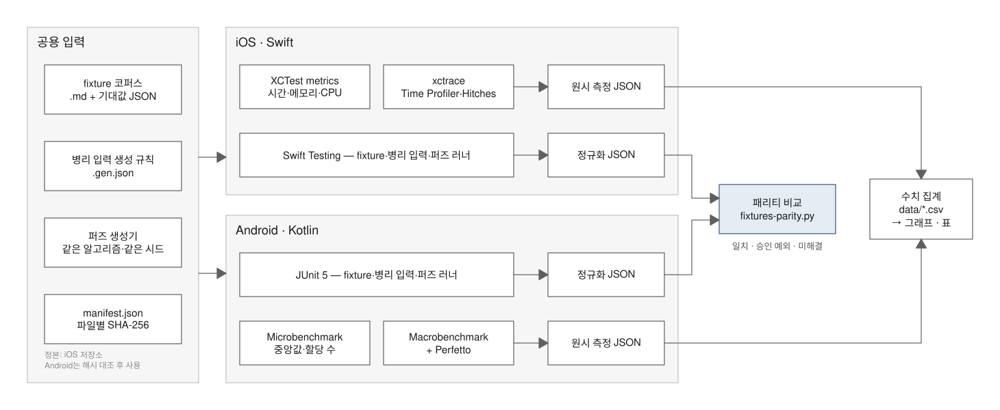

*그림 1. 검증 파이프라인*

두 플랫폼은 같은 입력 파일을 읽고 같은 형식의 결과를 냅니다. 입력 파일은 iOS 저장소가 정본이고, Android는 SHA-256 해시를 대조한 뒤 사용합니다. 비교 스크립트가 결과를 일치·승인 예외·미해결 차이로 나눕니다. 미해결 차이는 결함으로 보고 고친 뒤 같은 입력으로 다시 실행합니다.

보고서의 수치도 같은 원칙을 따릅니다. 원시 결과(벤치마크 JSON, 커버리지, 정적 분석 결과)를 스크립트가 CSV로 모으고, 그래프는 CSV만 읽어 그립니다. 사람이 수치를 옮겨 적는 단계가 없습니다.

### 2.2 테스트 계층

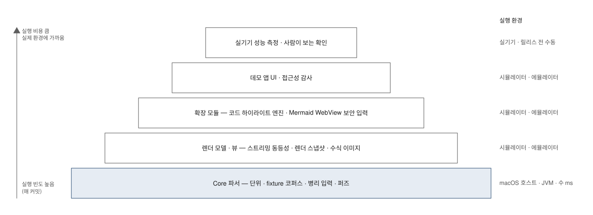

*그림 2. 테스트 계층과 실행 환경*

아래 계층일수록 자주, 빠르게 실행합니다. Core 파서는 macOS 호스트·JVM에서 수 ms 단위로 돌고, 위로 갈수록 시뮬레이터·에뮬레이터·실기기가 필요합니다.

### 2.3 사용 도구

| 구분 | 도구 | 하는 일 |
|---|---|---|
| 테스트 | Swift Testing · XCTest · XCUITest | iOS 단위·UI 테스트, 접근성 감사(`performAccessibilityAudit`) |
| 테스트 | JUnit · AndroidX Test · Espresso · ATF | Android 단위·계측 테스트, 접근성 검사(Accessibility Test Framework) |
| 성능 | XCTest metrics | 시간·CPU·메모리·앱 실행 시간을 반복 측정 |
| 성능 | Instruments(xctrace) · xcprof | Time Profiler·Animation Hitches·Activity Monitor 추적과 분석 |
| 성능 | Jetpack Microbenchmark · Macrobenchmark | 함수 지연·할당 수, 앱 실행·프레임 시간 측정(CPU 클럭 고정·워밍업 포함) |
| 성능 | dumpsys gfxinfo · Perfetto | Android 프레임 시간 히스토그램, 시스템 추적 |
| 보안 | semgrep 1.157.0 | 규칙 기반 정적 분석(Swift·Kotlin·JavaScript·OWASP Top 10) |
| 보안 | osv-scanner 2.7.0 · npm audit | 의존성의 알려진 취약점 조회 |
| 보안 | cdxgen 12.8.5 · CycloneDX | 소프트웨어 자재 명세서(SBOM) 생성 |
| 보안 | AddressSanitizer · ThreadSanitizer | 실행 중 메모리 오류·데이터 경합 탐지 |
| 품질 | xccov · Kover | 라인 커버리지(iOS·Android) |
| 품질 | lizard 1.24.1 · scc 4.1.0 · SwiftLint 0.62.2 · Android lint | 함수 복잡도, 코드 규모, 스타일·안티패턴 |
| 보고 | matplotlib 3.10 · Excalidraw · LibreOffice 26.8 | 그래프·도식, docx·pptx의 PDF 변환 |

### 2.4 실행 환경

| 구분 | 환경 |
|---|---|
| 호스트 | MacBook Pro (M4 Pro, 24 GB), macOS 26.6.2, Xcode 26.6 (iOS SDK 26.5), Swift 6.3.3 |
| iOS 실기기 | iPad Pro 11 (M5), iPadOS 26.6.2 — Release 빌드, 충전 중, 열 상태 정상 |
| iOS 시뮬레이터 | iPhone 16 Pro (iOS 18.6), iPhone 14 (iOS 16.4), iPhone 15 (iOS 17.5·18.6), iPhone 17 Pro (iOS 26.5) |
| Android 실기기 | Galaxy S20 Ultra (SM-G988N), Android 13 (API 33), 120 Hz — release·benchmark 빌드, CPU 클럭 고정 |
| Android 에뮬레이터 | Pixel 6 (API 37.1, 16 KB 페이지), API 30 |
| JVM | JetBrains Runtime 21, Kotlin 2.4, AGP 9.4, Gradle 9.6 |

시뮬레이터 Debug 빌드의 시간은 상대 비교에만 씁니다. 절대 성능은 실기기 Release 값만 인용합니다.

## 3. 테스트 보강

### 3.1 테스트 규모

| 항목 | 보강 전 | 보강 후 |
|---|---:|---:|
| iOS 패키지 테스트 함수 | 307 | 363 |
| iOS 매개변수 케이스(fixture·병리 입력 등) | 86 | 370 |
| iOS 데모 UI 테스트 | 23 | 26 (+ 수동 전용 측정·문서 캡처 10) |
| Android JVM 단위 테스트 케이스 | 187 | 1,017 |
| Android 계측 테스트 | 89 | 147 (API 37 기준) |
| 공용 fixture 입력(CommonMark 예제 포함) | 없음 | 847 |
| 퍼즈 | 없음 | CI 1만 회, 수동 10만 회 |

Swift Testing은 매개변수화한 테스트를 함수 하나로 셉니다. 그래서 fixture처럼 입력마다 실행되는 경우를 "매개변수 케이스"로 따로 적었습니다. CommonMark 명세 예제 652건은 한 테스트 안에서 반복합니다. JUnit은 매개변수 케이스를 하나씩 세므로 Android 단위 테스트 수에는 fixture·CommonMark 입력이 각각 들어갑니다(Core 935건).

### 3.2 공용 fixture 코퍼스

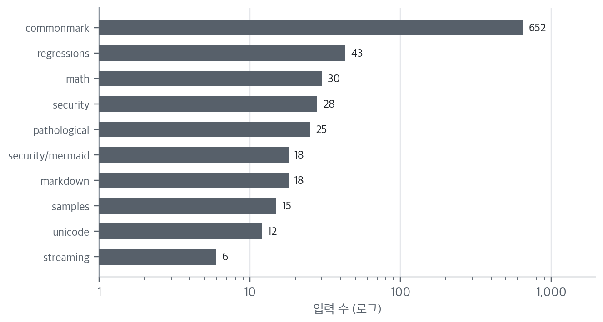

*그림 3. 공용 fixture 범주별 입력 수*

| 범주 | 내용 |
|---|---|
| commonmark | CommonMark 0.31.2 명세 예제 652건 — 무크래시·시간 상한 |
| markdown · math | GFM 표·취소선, 수식 경계(`\(`, `$`, `$$`, 이스케이프, 통화 기호) |
| unicode | 한글·이모지 ZWJ·결합 문자·RTL·서로게이트·BOM·CRLF·너비 없는 문자 |
| security | 링크 스킴(`javascript:`·`data:`·`file:`), HTML, 이미지, 방향 제어 문자 |
| security/mermaid | 스크립트 태그, 이벤트 속성, 클릭 콜백, `%%{init}%%` 설정 변경, 외부 이미지, 거대 입력 |
| pathological | 생성 규칙으로 만드는 극단 입력(중첩 500단계, 기호 10만 개, 900 KB 한 줄 등) |
| samples | LLM 답변 유형 샘플(수학·과학·코드·표·목록, 한국어) |
| regressions | 퍼즈와 패리티가 찾은 결함의 최소 입력 |
| streaming | 스트리밍 중간 상태(닫히지 않은 수식·표·코드 블록) |

### 3.3 퍼즈 테스트

퍼즈 테스트는 고정 시드의 난수로 입력을 변형해 넣고, 매번 지켜야 할 성질을 검사합니다. 두 플랫폼이 같은 알고리즘(SplitMix64)과 같은 시드로 **바이트 단위로 같은 입력열**을 만듭니다. 그래서 두 플랫폼의 결과를 입력별로 비교할 수 있습니다.

검사하는 성질은 다섯 가지입니다.

1. 크래시·예외 없이 끝난다.
2. 수식 보호와 복원을 거친 원문이 바이트 단위로 같다.
3. 모든 수식 구간이 원문 범위 안에 있고 UTF-8 경계에 맞는다.
4. 4 KiB를 넘는 수식에는 "수식 원문 초과" 진단이 붙는다.
5. 입력 상한(256 KiB, 인용 64단계, 목록 들여쓰기 48열)을 지킨다.

| 실행 | 횟수 | iOS | Android | 결과 |
|---|---:|---:|---:|---|
| CI | 10,000 | 11.3초 (시뮬레이터 Debug) | 1.7초 (JVM) | 무크래시, 성질 위반 0 |
| 수동 | 100,000 | 124초 (macOS 호스트 Debug, 덤프 포함) | 10.2초 (JVM, 덤프 포함) | 무크래시, 성질 위반 0 |

iOS 시간은 최적화하지 않은 Debug 빌드라 깁니다. 릴리스 빌드의 파싱 시간은 5.2절의 실기기 값을 봅니다. 덤프는 패리티 비교를 위해 입력과 결과를 파일로 쓰는 설정입니다.

### 3.4 플랫폼 패리티

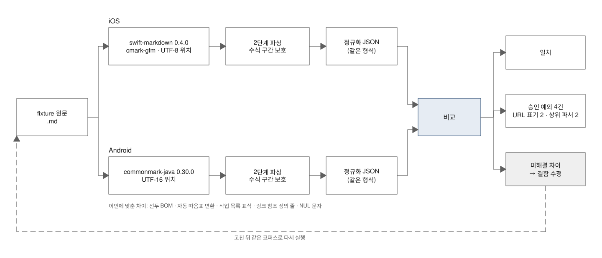

*그림 4. 플랫폼 패리티 비교*


*그림 5. iOS·Android 정규화 결과 비교*

정규화 결과에는 블록 종류·순서, 글자, 강조 범위, 링크 주소, 수식 구간, 표 크기가 들어 있습니다. 차이가 나면 원인을 찾아 어느 쪽이 명세에 맞는지 판정하고, 틀린 쪽을 고쳤습니다. 이렇게 패리티 비교에서 찾아 고친 결함이 26건입니다(4.1절).

남은 차이는 두 종류입니다.

- **승인 예외 4건**: URL 표기 2건(iOS는 국제화 도메인을 punycode로, 경로의 비ASCII를 퍼센트 인코딩으로 표기)과 상위 파서 2건(8자리 숫자 문자 참조, 통화 기호의 구두점 판정)입니다. 링크 대상은 같고, 상위 파서 2건은 명세 해석 차이입니다.
- **퍼즈 잔여 차이**: 10만 건 중 409건이며, 분류 스크립트(`scripts/fuzz-residual.py`)가 전부 상위 파서 규칙 차이로 분류합니다(4.4절 D-05~D-09). 분류하지 못한 차이는 0건입니다.

| 원인 | 건수 | 내용 |
|---|---:|---|
| 표 인식 (D-05) | 254 | 표 머리글·구분선 열 수 불일치를 Android가 허용 |
| 강조·취소선 규칙 (D-06) | 74 | 짝이 어긋난 강조 구분자 해석 차이 |
| 표 행 범위 (D-05) | 44 | 들여쓰기가 모자라거나 `>`로 시작하는 줄을 Android가 표 행으로 이음 |
| 목록 안 표 행 (D-05) | 34 | 목록 안 게으른 줄을 Android가 표 행으로 이음 |
| 코드 블록 끝 공백 줄 (D-07) | 1 | 닫히지 않은 펜스의 마지막 공백 줄 |
| 참조 정의 뒤 빈 항목 (D-08) | 1 | 참조 정의 다음 줄의 `*`를 Android가 빈 목록으로 봄. iOS가 명세와 같음 |
| 펜스 정보의 `~` (D-09) | 1 | 백틱 펜스 정보 문자열의 `~`를 Android가 거부. iOS가 명세와 같음 |

1만 건에서는 9,957건이 일치하고 나머지 43건이 같은 원인(표 인식 24, 표 행 범위 8, 강조 8, 목록 안 표 행 3)으로 나뉩니다.

## 4. 정확성·견고성 (Q1)

### 4.1 발견·수정한 결함

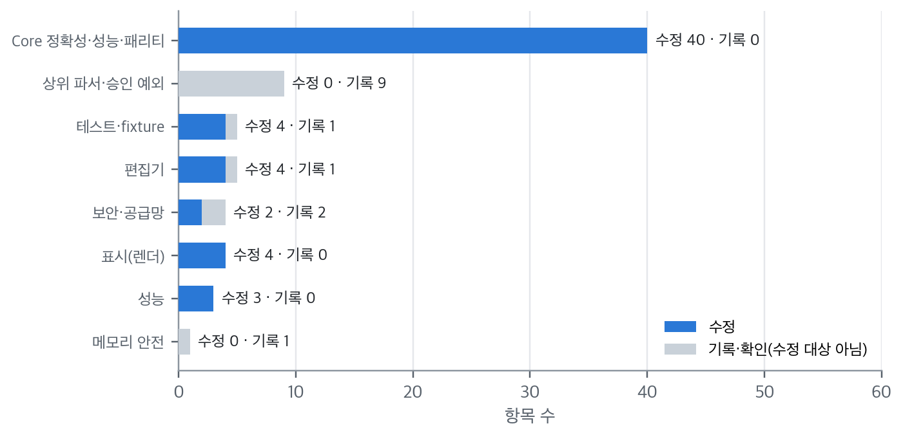

*그림 6. 결함 분류별 처리 현황*

| ID | 분류 | 대상 | 발견 경로 | 내용 | 조치 |
|---|---|---|---|---|---|
| F-01 | 크래시 | iOS Core | 병리 입력 | 중첩 목록 65단계 이상에서 재귀 변환이 스레드 스택(512 KB)을 넘어 SIGBUS | 목록 들여쓰기 48열 상한(두 플랫폼) |
| F-02 | 성능 O(n²) | 양 플랫폼 Core | 병리 입력 | 한 줄에 수식 구간 2만 개가 있으면 줄 끝 탐색·구간 필터가 반복 | 줄 종료 위치 배열 + 이진 탐색 |
| F-03 | 성능 O(n²) | 양 플랫폼 Core | 병리 입력 | 닫히지 않은 `\(` 1만 개에서 opener마다 줄 끝까지 재탐색 | 같은 줄 미종료 판정 캐시 |
| F-04 | 계약 미구현 | 양 플랫폼 Core | fixture·퍼즈 | 4 KiB 초과 수식 진단이 정의만 있고 발생하지 않음 | 스캐너가 진단 추가 |
| F-05 | 가림 문자 노출 | iOS Core | 보안 fixture | NUL 바이트를 cmark가 3바이트 문자로 바꿔 1·2차 파싱 위치가 어긋남 | NUL을 U+FFFD로 미리 치환 |
| F-15 | 글자 손실·깨짐 | iOS Core | 퍼즈 패리티 | 들여쓴 연속 줄에서 swift-cmark 인라인 위치가 떼어 낸 공백만큼 밀림. 끝 글자가 사라지고 인용 줄의 한글이 바이트 중간에서 잘림 | 줄별 열 보정(`InlineColumnShift`) |
| F-16 | 가림 문자 노출 | iOS Core | 퍼즈 패리티 | 목록·인용의 게으른 연속 줄에서 위치가 오른쪽으로 밀려 수식 대신 `xxxxx` 표시 | 연속 줄 기준 열 보정 |
| F-22 | 글자 쓰레기 | iOS Core | 퍼즈 패리티 | 역슬래시 줄바꿈 뒤 줄 번호를 줄바꿈 수만큼 앞당겨 보고 | 문단별 줄 지연 보정 |
| F-23 | 가림 문자 노출 | iOS Core | 퍼즈 10만 회 | 표 바로 앞 문단의 위치 정보를 표 확장이 지움 | 가린 버퍼에서 글자 순서로 복원 |
| F-26 | 이스케이프 오인 | iOS Core | 퍼즈 10만 회 | `String.contains`가 문자 묶음 단위라 `\(` 뒤 결합 문자가 붙으면 이스케이프를 못 찾음 | 바이트 단위 검사 |
| F-30·31 | 최소 OS | iOS Core (iOS 16) | 최종 재실행(iOS 16.4) | iOS 16 URL 파서가 규격 밖 글자(조각의 두 번째 `#`, 공백 등)에서 실패해 링크가 글자로 표시되고, 깨진 포트는 받아들임 | iOS 17과 같은 구성 요소 단위 대체 인코딩, 포트 숫자 검사 |
| F-32 | 글자 밀림·수식 손실 | iOS Core | 퍼즈 잔여 분류 | 표 머리글 줄만 들여쓰면 이후 행의 셀이 한 칸씩 밀려 `\(x^2\)`의 역슬래시가 사라짐 | 표 행 열 보정 |
| F-33 | 글자 손실 | 양 플랫폼 Core | 퍼즈 잔여 분류 | 표 셀 안 이스케이프한 세로선 뒤 위치가 앞당겨져 끝 글자가 깨지거나(iOS) 사라짐(Android) | 셀 단위 위치 보정(두 플랫폼 같은 규칙) |
| F-40 | 견고성 | iOS Core | 최종 ASan 재실행 | Debug·ASan 빌드에서 인용 64단계 입력이 협력 스레드 스택(512 KB)을 넘음. 블록 변환 함수 한 프레임이 8 KB 이상 | 변환 함수를 얇은 분기와 case별 함수로 분리. 릴리스 빌드는 원래 영향 없음 |
| F-34~39 | 글자 손실·누출 | iOS Core | 퍼즈 잔여 분류 | `\`만 있는 줄, 짝 없는 `~` 셀, 표 앞 문단 이스케이프, 하드 줄바꿈 뒤 공백, 게으른 인용 줄의 줄바꿈 누출, 할 일 상자 공백 | 줄 넘김 판정·셀 경계 제한·이스케이프 허용 검색 등 |
| R-03 | 호환성 | 공용 Mermaid 번들 | Android 계측(API 30) | Android System WebView 93 미만에서 `Object.hasOwn` 부재로 번들 로드 실패, 모든 다이어그램이 원문 표시 | 없을 때만 정의하는 polyfill 4종, 문법 대상 chrome91 |
| E-01 | 화면 결함 | Android 편집기 | 실기기 육안 | 아래 패딩 96dp 구간에 글자를 그리지 않아 스크롤 중 줄이 잘림 | 그리는 동안만 패딩 0 |
| E-02 | 동작 결함 | Android 편집기 | 실기기 육안 | 드래그 스크롤 뒤 캐럿이 옮겨져 수식 블록이 원문으로 바뀜 | 캐럿 자동 이동 끔 |
| E-03 | 화면 결함 | iOS 편집기 | 커버리지 테스트 | 연속 인용 블록의 세로 바가 줄마다 끊김 | 같은 색 스타일을 같은 구간으로 비교 |
| E-04 | 화면 결함 | iOS 편집기(iOS 26) | 커버리지 테스트 | 문서 끝 인용의 바가 한 줄 더 길게 그려짐 | 끝 줄바꿈을 빼고 측정 |
| R-01 | 화면 결함 | iOS UIKit | 렌더 스냅샷 | 다크 모드 블록 수식이 LaTeX 원문으로 표시(색 값 범위 초과) | 색 값을 0–1로 고정해 전달 |
| R-02 | 접근성 | iOS UIKit | 접근성 감사 | 단독 수식 뷰에 접근성 특성이 없어 감사 실패 | 정적 텍스트 특성 지정 |
| S-02 | 보안 강화 | 양 플랫폼 링크 정책 | 퍼즈 패리티 | 주소에 보이지 않는 서식 문자가 있어도 링크로 만듦 | 너비 없는 문자·방향 제어 문자가 있으면 링크 아님 |
| P-02 | 성능 | iOS UIKit | 실기기 벤치마크 | 스트리밍으로 Mermaid 원문이 자라는 tick마다 WKWebView를 새로 만듦 | 기존 뷰의 원문만 갱신 |
| P-03 | 성능 회귀 | iOS Core | 실기기 재측정 | 위치 보정(F-15~F-39)을 넣은 뒤 50 KiB 파싱이 0.9.1 대비 약 2배. 파싱마다 swift-markdown 트리를 네 번 순회 | 순회 한 번으로 통합, 1차 보정은 필요할 때만 생성. 출력은 퍼즈 10만 회·fixture 전체에서 동일 |

표는 대표 항목입니다. 전체 목록과 발견 경로·검증 결과는 부록 A에 있습니다. Core 결함 대부분은 퍼즈 패리티가 찾았습니다. 한 플랫폼만 테스트했다면 기대값을 사람이 일일이 정해야 해서 찾기 어려웠을 결함입니다. 퍼즈 잔여 차이를 원인별로 끝까지 분류하는 과정에서도 결함 8종(F-32~F-39)이 추가로 드러났습니다. 이 보정은 파싱 비용을 늘렸고, 최종 코드로 실기기를 다시 측정하다 이를 발견해 결과를 바꾸지 않는 범위에서 줄였습니다(P-03, 5.2절).

### 4.2 병리 입력

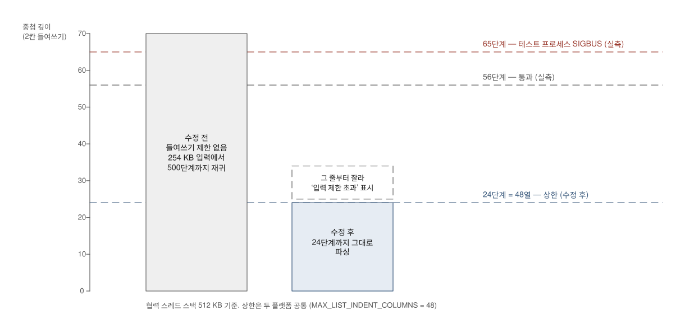

*그림 7. 중첩 목록 상한*

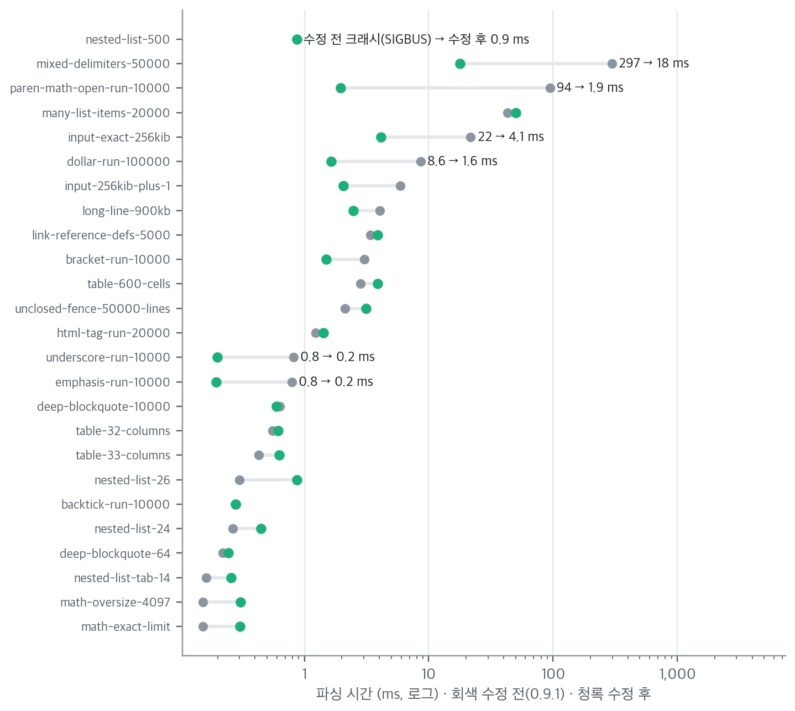

*그림 8. 병리 입력별 파싱 시간 — 수정 전(0.9.1) 대 수정 후 (macOS 호스트 Release)*

병리 입력 25종을 수정 전(0.9.1) Core와 최종 Core로 같은 조건(macOS 호스트 릴리스 빌드, 512 KB 스택 스레드)에서 3회씩 파싱하고 중앙값을 비교했습니다. 수정 전에는 nested-list-500이 크래시(SIGBUS)했고, 최종 Core는 0.9 ms에 끝납니다. 크래시하지 않은 입력 중 가장 오래 걸린 mixed-delimiters-50000은 297 ms에서 18 ms로, paren-math-open-run-10000은 94 ms에서 1.9 ms로 줄었습니다. 최종 Core에서 25종 전체가 100 ms 안에 끝납니다. 같은 입력도 측정할 때마다 수 % 흔들리므로(0.9.1 최악 입력 297–313 ms) 작은 차이는 해석하지 않습니다.

반대로 1 ms 이상 걸리면서 20% 넘게 느려진 입력이 2종 있습니다. table-600-cells는 2.8 ms에서 3.9 ms로, unclosed-fence-50000-lines는 2.1 ms에서 3.1 ms로 늘었습니다. 위치 보정(F-15~F-39)이 하는 일이 늘어난 결과입니다. 보정을 넣은 직후에는 many-list-items-20000이 44 ms에서 78 ms까지 늘었으나, 트리 순회를 줄인 뒤(P-03) 50 ms가 되었습니다. 가장 느린 입력도 시간 예산(1–3초)의 1.7%라 판정은 바뀌지 않습니다.

### 4.3 렌더·확장·접근성

| 항목 | iOS | Android |
|---|---|---|
| 스트리밍 동등성(조각으로 흘린 결과 = 한 번에 렌더한 결과) | 입력 × 조각 크기 25개 | 25개, Compose·View 양쪽 비교, 게시 순서(최신 입력 우선) 확인 |
| 렌더 스냅샷 | 대표 입력 × 라이트·다크 × 글자 크기, 40장 | 없음 — 화면 구조 비교(스트리밍 동등성)로 대신함 |
| 코드 하이라이트 | 번들 언어 16종 전수, 별칭 7종, 범위 경계 19종 | 언어 19종 전수, 엔진 오염 시도 이름 12종(`__proto__` 등), 상한 직전 입력 214 ms |
| Mermaid 공격 입력 | 18종 전부 차단(6.3절) | 18종 전부 차단, WebView 설정 기준 5종 고정(API 30·37) |
| 접근성 | 데모 전 화면 자동 감사 — 기본·다크·최대 글자 크기 | ATF 4.1.1, 데모 8개 화면 라이트·다크, 오류 0건(Compose 글자 대비는 ATF가 읽지 못해 미검사) |
| 최소 OS | iOS 16.4·17.5 시뮬레이터에서 Core·표시·Mermaid 테스트 251개 통과(각각) | API 30 에뮬레이터에서 표시 46·Mermaid 42개 통과. 데모 접근성 2개는 ATF 한계로 API 33 미만에서 건너뜀 |
| 편집기 다크 모드 실시간 전환 | iOS 17.5·26.5 시뮬레이터 육안 확인(본문·인용 바·수식·인라인 코드) | — |

### 4.4 상위 파서 차이

두 플랫폼은 서로 다른 오픈소스 파서를 씁니다. 파서끼리 명세 해석이 다른 곳은 고치지 않고 기록합니다.

| ID | 내용 | 영향 |
|---|---|---|
| D-03 | iOS cmark-gfm이 8자리 숫자 문자 참조를 U+FFFD로 해석(명세는 원문 유지) | 극히 드문 입력 |
| D-04 | iOS cmark-gfm이 통화 기호를 구두점으로 보지 않음(`*£*`가 기울임) | 강조 여부만 다름 |
| D-05 | Android commonmark-java가 표 머리글·구분선 열 수 불일치를 허용하고, 목록 안 게으른 줄을 표 행으로 붙임 | 한쪽은 표, 한쪽은 문단 |
| D-06 | 짝이 어긋난 강조·취소선 구분자의 해석 규칙이 다름 | 강조 범위만 다름 |
| D-07 | 닫히지 않은 코드 펜스의 마지막 공백 줄을 iOS는 남기고 Android는 뺌 | 공백 줄 하나 |
| D-08 | Android가 링크 참조 정의 바로 다음 줄의 `*`를 빈 목록 항목으로 봄(명세상 iOS가 맞음) | `*` 글자 대신 빈 글머리표 |
| D-09 | Android가 백틱 펜스 정보 문자열에 `~`가 있으면 펜스로 보지 않음(명세상 iOS가 맞음) | 코드 블록 대신 문단 |

## 5. 성능 (Q2)

### 5.1 측정 구성

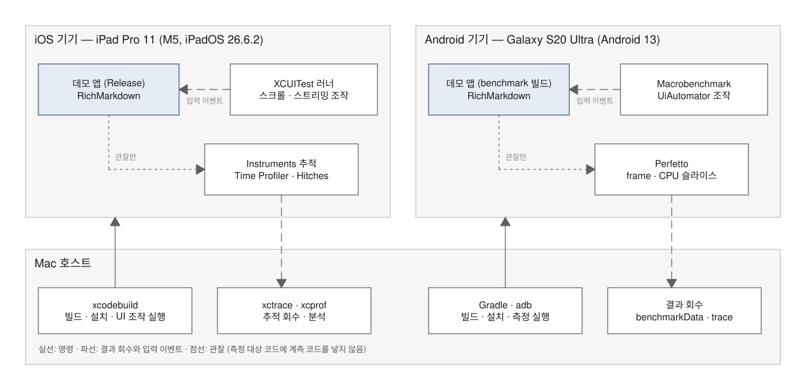

*그림 9. 실기기 성능 측정 구성*

측정 대상 코드에는 계측 코드를 넣지 않았습니다. UI 자동화가 입력을 넣고 Instruments·Perfetto가 밖에서 관찰합니다.

iOS 마이크로 벤치마크는 최종 코드로 측정했습니다. 트레이스 시나리오와 도구 교차 확인은 F-40(Debug 빌드 스택을 줄이려는 함수 분리) 직전 빌드로 측정했고, 이 변경은 출력과 릴리스 파싱 시간(iPad 50 KiB 11.5 ms)을 바꾸지 않았습니다. Android 마이크로 벤치마크는 최종 코드, Macrobenchmark·gfxinfo는 같은 날 F-33 수정 이전 빌드입니다.

### 5.2 파싱 지연


*그림 10. 입력 크기별 파싱 시간 (점: 반복별 값, 선: 중앙값)*

| 항목 | iOS 중앙값 | iOS p90 | Android 중앙값 | Android 최소 |
|---|---:|---:|---:|---:|
| 파싱 1 KiB | 0.29 ms | 0.31 ms | 1.40 ms | 1.34 ms |
| 파싱 10 KiB | 2.59 ms | 2.75 ms | 12.42 ms | 11.81 ms |
| 파싱 50 KiB | 11.49 ms | 11.59 ms | 58.81 ms | 54.54 ms |
| 파싱 256 KiB | 59.25 ms | 59.59 ms | 303.96 ms | 294.03 ms |
| MathScanner 50 KiB | 0.35 ms | 0.37 ms | 2.10 ms | 1.96 ms |
| 수식 보호·복원 50 KiB | 0.02 ms | 0.03 ms | 0.13 ms | 0.12 ms |

iOS는 iPad Pro 11 (M5) Release 10회, Android는 Galaxy S20 Ultra release 50회 측정입니다. 두 기기는 출시 연도와 칩 세대가 달라 플랫폼끼리 절대값을 비교하지 않습니다. 두 플랫폼 모두 입력 크기에 비례해 늘고, 입력 상한인 256 KiB에서 iPad는 59 ms, Galaxy S20 Ultra는 304 ms가 걸립니다.

위치 보정(F-15~F-39)을 넣은 직후 iPad의 50 KiB 파싱은 오전 측정 11.8 ms에서 16.9 ms로 늘었습니다. 표본 추출로 원인을 찾아 트리 순회를 줄인 뒤 11.5 ms가 되었습니다(P-03). MathScanner 단독 측정은 오전 0.15 ms에서 0.35 ms로 늘었지만 파싱 전체의 3% 수준입니다.

파싱은 메인 스레드 밖에서 실행되고 최신 입력만 처리합니다. 파싱이 20 Hz 갱신 간격(50 ms)보다 길어도 화면은 멈추지 않고 중간 상태 일부를 건너뜁니다. iOS 테스트는 250 KiB 파싱 중에도 메인 스레드가 막히지 않는지 확인합니다.

### 5.3 스트리밍·스크롤 끊김


*그림 11. iOS 시나리오별 hitch 시간 비율 (iPad Pro M5, Animation Hitches, 시나리오별 3회 중앙값, 가는 선은 최소–최대)*

hitch 시간 비율은 화면이 제때 그려지지 못한 시간을 초당 ms로 나타낸 값입니다. Apple은 5 ms/s 미만을 양호, 5–10 ms/s를 사용자가 끊김을 알아채 조사가 필요한 수준, 10 ms/s 초과를 경험을 크게 해치는 수준으로 안내합니다[3].

- 스크롤·화면 진입·앱 실행은 중앙값이 모두 5 ms/s 미만입니다. 콜드 런치는 3회 중 1회만 23.1 ms/s였습니다.
- 20 Hz 스트리밍은 UIKit 5.5 ms/s(4.7–12.7, 조사 필요 구간), SwiftUI 15.9 ms/s(15.1–18.3, 경험을 크게 해치는 구간)로 기준을 넘습니다. 메인 스레드 상위 비용은 SwiftUI의 게시 단계(`publishPending`, 238 ms)입니다.
- 오전 1회 측정에서 SwiftUI 스트리밍은 11.8 ms/s였습니다. 같은 구간의 메인 스레드 작업량은 오전 1,691 ms, 최종 1,650 ms로 비슷해 앱 코드 회귀보다 측정 변동으로 보이지만, 1회 값과 비교한 것이라 확정하지 않습니다.
- UI 자동화가 화면을 조회하는 접근성 호출이 메인 스레드에서 약 420 ms를 차지합니다. 실제 사용자 조작에는 없는 비용이라 hitch 일부는 측정 도구의 영향입니다.

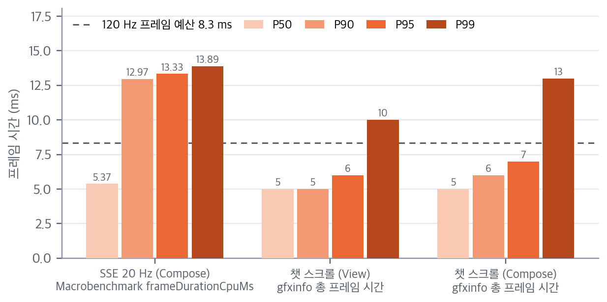

*그림 12. Android 프레임 시간 백분위 (Galaxy S20 Ultra, 120 Hz)*

Android 스크롤은 P90이 5–6 ms로 120 Hz 예산 8.3 ms 안입니다. 20 Hz 스트리밍은 P90 13.0 ms로 예산을 넘습니다. 스트리밍 tick마다 재파싱·재배치가 일어나기 때문이며, iOS와 같은 개선 대상입니다. 스크롤 값은 `dumpsys gfxinfo`의 총 프레임 시간이고 스트리밍 값은 Macrobenchmark의 CPU 프레임 시간이라 서로 다른 지표입니다.

### 5.4 메모리

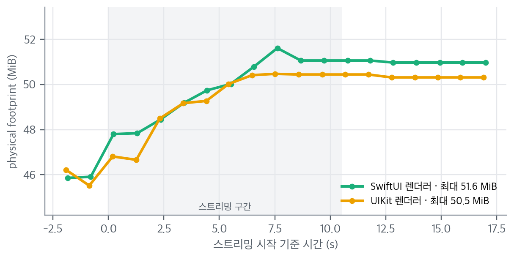

*그림 13. 스트리밍 중 메모리 (iPad Pro M5, Activity Monitor 약 1초 간격)*

스트리밍 동안 5–6 MiB 늘고, 끝난 뒤에는 그 수준을 유지합니다. 늘어난 양은 렌더한 블록과 수식 이미지 캐시입니다. 스트리밍이 끝난 뒤 계속 늘지 않으므로 누수 징후는 없습니다.

### 5.5 앱 실행 시간

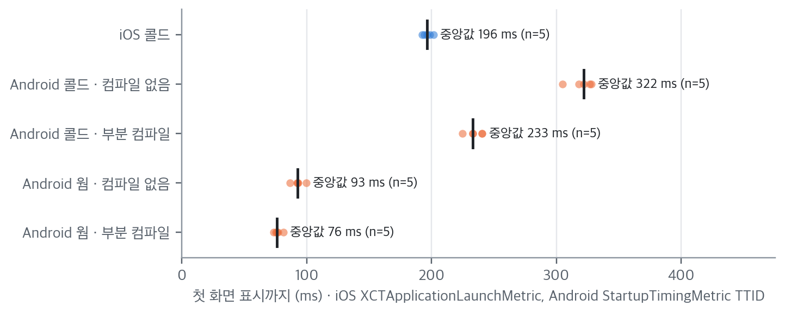

*그림 14. 데모 앱 실행 시간*

iOS 콜드 실행 중앙값은 196 ms입니다(5회, 193–202 ms). Android 콜드 실행은 설치 직후 322 ms, 프로파일 컴파일 후 233 ms입니다. Android 콜드 측정 3건은 기기 온도가 높은 상태(thermal 2)였으므로 참고값입니다.

### 5.6 앱 크기

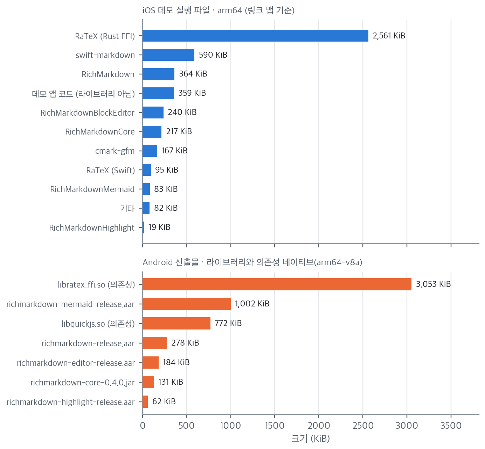

*그림 15. 모듈별 크기*

| 항목 | 값 |
|---|---|
| iOS App Thinning(데모 전체, 기기별) | 압축 3.5 MB · 비압축 9.5 MB |
| iOS 실행 파일 묶음 | RaTeX 2,657 KiB(55.6%), RichMarkdown 모듈 923 KiB(19.3%), swift-markdown·cmark 758 KiB(15.9%) |
| iOS 리소스 | Mermaid 번들 3,492 KiB(zip 947), RaTeX 서체 544 KiB, Prism 156 KiB |
| Android 라이브러리 AAR·JAR 합계(0.4.0) | 1,657 KiB (mermaid 1,002 포함) |
| Android 의존성 네이티브(arm64-v8a) | RaTeX 3,053 KiB, QuickJS 772 KiB |

크기의 대부분은 수식 엔진 RaTeX입니다. Mermaid는 선택 모듈이라 쓰지 않으면 웹 번들이 빠집니다. Android 16 KB 페이지 정렬은 64비트 ABI 전부 통과했습니다.

### 5.7 도구 교차 확인

| 측정 | 도구 | 값 |
|---|---|---:|
| 50 KiB 파싱 50회 + 예열 1회 (iPad Pro M5) | Time Profiler 중 `RichMarkdownParser.parse` | 592 ms |
| 같은 구간 | os_signpost `parse` 구간 51개 | 591.3 ms |
| 같은 구간 | XCTClockMetric 50회 합 | 587.7 ms |

원리가 다른 두 도구(표본 추출과 구간 기록)가 0.1% 안에서 일치합니다. XCTClockMetric은 예열 1회를 빼고 측정 50회만 더한 값이라 조금 작고, 세 값의 차이는 1% 안입니다.

### 5.8 성능 판정

| 기준 | 결과 | 판정 |
|---|---|---|
| 50 KiB 파싱 p50 < 300 ms (시뮬레이터 Debug 게이트) | 78.7 ms (최적화 전 146.1 ms) | 통과 |
| 스크롤 hitch < 5 ms/s (iOS), 프레임 P90 < 8.3 ms (Android) | 0.64–1.9 ms/s, 5–6 ms | 통과 |
| 20 Hz 스트리밍 hitch < 5 ms/s, P90 < 8.3 ms | 5.5–15.9 ms/s, 13.0 ms | **미달 — 개선 대상** |
| 스트리밍 뒤 메모리 증가 지속 없음 | 5–6 MiB 증가 후 유지 | 통과 |

## 6. 보안 (Q3)

### 6.1 위협 모델

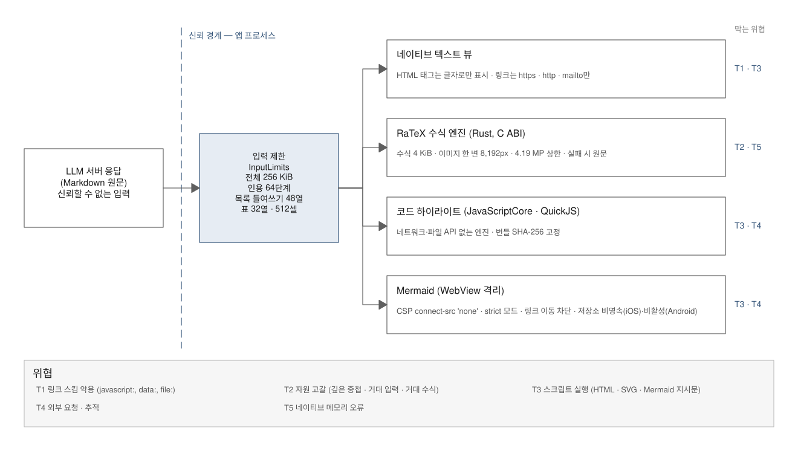

*그림 16. 위협 모델*

LLM 답변은 신뢰할 수 없는 입력으로 다룹니다. 답변은 먼저 입력 제한을 거치고, 표시 경로마다 다른 방어를 둡니다.

| 위협 | 방어 | 검증 |
|---|---|---|
| T1 링크 스킴 악용 | `https`·`http`·`mailto`만 링크. 보이지 않는 서식 문자가 있으면 링크 아님 | 보안 fixture 28건, 퍼즈 |
| T2 자원 고갈 | 입력 256 KiB, 인용 64단계, 목록 들여쓰기 48열, 표 32열·512셀, 수식 4 KiB, 수식 이미지 한 변 8,192 px·4.19 MP | 병리 입력 25종 |
| T3 스크립트 실행 | 네이티브 뷰는 HTML을 글자로 표시. Mermaid는 CSP·`securityLevel: strict`·DOMPurify | Mermaid 공격 입력 18종 |
| T4 외부 요청 | 번들 로컬 파일만 로드, `connect-src 'none'`, 링크 이동 차단 | 외부 요청 0건 검사 |
| T5 네이티브 메모리 오류 | Rust 엔진 입력 상한, ASan·TSan 실행 | 6.4절 |

### 6.2 정적 분석·의존성 감사

| 검사 | iOS | Android |
|---|---|---|
| semgrep (`p/swift`·`p/kotlin`·`p/javascript`·`p/owasp-top-ten`) | 지적 0건 (파일 138개) | 지적 6건, 전부 데모 앱의 `exported` 화면(스크린샷 자동화용). 라이브러리 0건 (파일 133개) |
| osv-scanner | 알려진 취약점 0건 | 0건 (릴리스 런타임 컴포넌트 97개) |
| npm audit (Mermaid 웹 번들 빌드) | 0건 | 같은 번들 |
| SBOM (CycloneDX) | Swift 의존성·Mermaid 웹 번들 2종 | 릴리스 런타임 1종 |

### 6.3 Mermaid WebView

| 항목 | 기준 | iOS | Android |
|---|---|---|---|
| 자산 출처 | 번들 로컬 파일만 | `loadFileURL`, 자산 폴더 한정 | `WebViewAssetLoader` |
| CSP | `default-src 'none'`, `connect-src 'none'`, 스크립트 해시 고정 | 적용 | 같은 HTML |
| 네비게이션 | 다이어그램 안 링크·외부 이동 차단 | 로컬·비링크 로드만 허용 | 전부 차단 |
| 새 창·파일 접근 | 금지 | 금지 | 금지 |
| 저장소 | 쓰지 않음 | 비영속 저장소 | DOM 저장소 꺼짐(기본값) |
| JS 브리지 | 최소 | 반환값만, 메시지 핸들러 없음 | 메서드 2개(결과·오류) |
| 원문 전달 | 코드가 아니라 인자로 | `callAsyncJavaScript` 인자 | JSON 인용 인자 |
| Mermaid 설정 | `securityLevel: strict`, HTML 라벨 끔, 지시문으로 변경 불가 | 회귀 테스트로 고정 | 같은 번들 |
| 웹 디버깅 | 릴리스 비활성 | 기본 꺼짐 | 호출 없음 |

| 공격 입력 (18종) | 결과 |
|---|---|
| 라벨의 `<script>`, ``, `<iframe srcdoc>`, `javascript:` 링크 | 실행 없음 |
| 클릭 콜백(`click A call …`, `click A href "javascript:…"`) | 실행 없음 |
| `%%{init}%%`로 `securityLevel: loose`·HTML 라벨 켜기 | 설정 변경 거부 |
| 외부 이미지·외부 링크·`classDef` 스타일 URL | 외부 요청 0건 |
| 엔티티 인코딩 스크립트, Markdown 문자열 링크, 시퀀스 노트 HTML | 실행 없음 |
| 간선 600개·글자 100 KB | 상한으로 거부, 앱 정상 |

### 6.4 메모리 안전

iOS 패키지 테스트 전체를 AddressSanitizer와 ThreadSanitizer로 각각 실행했습니다. 메모리 오류 0건, 데이터 경합 0건입니다. 최종 코드로 다시 실행했을 때 ASan 빌드에서 깊은 중첩 테스트 2개가 스택 넘침으로 멈췄습니다. 메모리 오류가 아니라 Debug·ASan 빌드의 큰 스택 프레임 때문이었고, 릴리스 빌드는 최대 허용 깊이에서도 스레드 기본 비용 수준(112~116 KB)만 썼습니다. 개발자가 Debug로 앱을 돌릴 때의 여유를 위해 블록 변환 재귀의 프레임을 줄였습니다(F-40). RaTeX(Rust)와 JavaScriptCore를 부르는 경로도 포함됩니다. 새니타이저는 실행 시간을 몇 배 늘리므로, 시간 기준 테스트 1건은 새니타이저 실행에서 수치만 남기도록 바꿨습니다(P-01).

## 7. 코드 품질·유지보수 (Q4)

### 7.1 커버리지

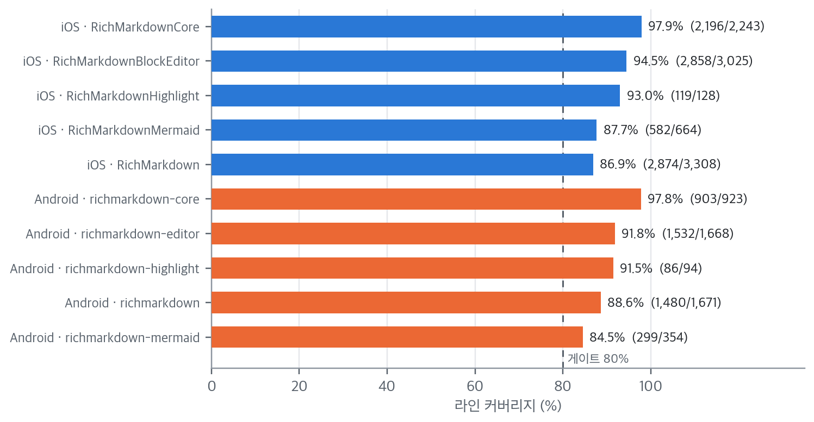

*그림 17. 모듈별 라인 커버리지*

| 모듈 | 보강 전 | 보강 후 |
|---|---:|---:|
| iOS Core | 94.8% | 97.9% |
| iOS 표시(RichMarkdown) | 85.0% | 86.9% |
| iOS 블록 편집기 | 77.0% | 94.5% |
| iOS 하이라이트 | 93.0% | 93.0% |
| iOS Mermaid | 85.9% | 87.7% |
| **iOS 전체** | **84.0%** | **92.1%** |
| Android core | 측정 도구 없음 | 97.8% (JVM 단위) |
| Android 표시(richmarkdown) | 측정 도구 없음 | 88.6% |
| Android 편집기 | 측정 도구 없음 | 91.8% |
| Android 하이라이트 | 측정 도구 없음 | 91.5% |
| Android Mermaid | 측정 도구 없음 | 84.5% |
| **Android 전체** | — | **91.3%** |

Android는 JVM 단위 테스트를 Kover로, 에뮬레이터 계측 테스트를 AGP JaCoCo로 측정한 뒤 줄 단위로 합쳤습니다(어느 한쪽에서라도 실행된 줄을 커버로 봅니다). Compose·View·WebView 경로는 계측 테스트에서만 실행되기 때문입니다. CI는 계측 테스트를 돌리지 않으므로 커밋 기준은 Core 90%(Kover)만 둡니다.

### 7.2 복잡도와 규모

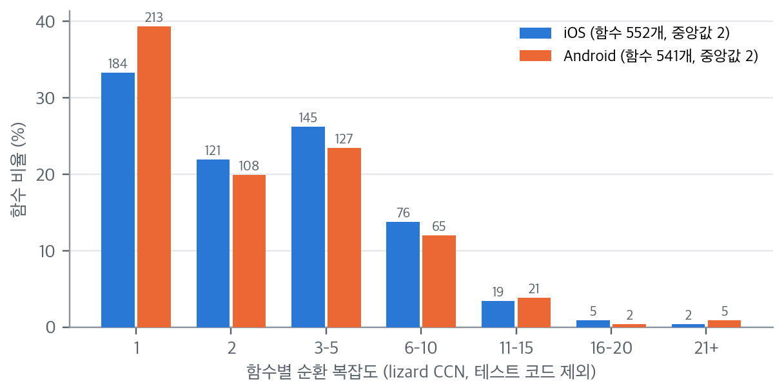

*그림 18. 함수별 순환 복잡도 분포 (테스트 코드 제외)*

| 항목 | iOS | Android |
|---|---:|---:|
| 소스 코드 줄(Swift·Kotlin, 번들 JavaScript 제외) | 8,638 | 7,229 |
| 테스트 코드 줄 | 7,920 | 6,238 |
| 함수 수(테스트 제외) | 552 | 541 |
| 함수 복잡도 중앙값 · 평균 | 2 · 3.46 | 2 · 3.37 |
| 복잡도 16 이상 함수 | 7 (최대 28) | 7 (최대 34) |

복잡도가 가장 높은 함수는 iOS가 swift-cmark 위치 보정을 계산하는 `InlineColumnShift.init`(28), Android가 스트리밍 중 닫히지 않은 강조 기호를 숨기는 `strippingUnclosedOpeners`(34)입니다. 앞의 것은 상위 파서의 위치 오류 유형별 분기가, 뒤의 것은 구분자 종류별 분기가 많기 때문입니다. 두 함수 모두 퍼즈 10만 회 패리티와 회귀 fixture가 지나는 경로입니다.

SwiftLint 기본 규칙 위반은 157건입니다. 대부분 짧은 변수명(30)·줄 길이(28)·후행 쉼표(26) 같은 스타일 항목이고, 저장소에 SwiftLint 설정 파일은 없습니다. 앱을 멈출 수 있는 강제 캐스트 2건은 `layerClass`가 `CAShapeLayer`를 돌려주는 뷰라 항상 성공합니다. Android lint는 오류 0건입니다.

### 7.3 CI 게이트

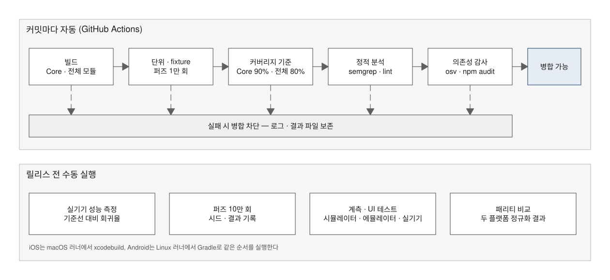

*그림 19. CI 게이트*

두 저장소에 GitHub Actions 워크플로를 넣었습니다. iOS는 macOS 러너에서 xcodebuild로, Android는 Linux 러너에서 Gradle로 같은 순서를 실행합니다. 실기기 성능·10만 회 퍼즈·계측 테스트는 릴리스 전에 수동으로 실행합니다. 워크플로 실행 결과는 각 저장소의 Actions 탭에서 확인합니다.

## 8. 남은 조건과 확인하지 않은 범위

| 항목 | 상태 | 다음 조치 |
|---|---|---|
| 20 Hz 스트리밍 끊김 | iOS UIKit 5.5·SwiftUI 15.9 ms/s(3회 중앙값), Android P90 13.0 ms | 스트리밍 경로 최적화(게시 빈도 조절·블록 단위 재사용) 후 같은 스크립트로 재측정 |
| iPhone·저사양 iPad 실기기 성능 | 미측정. iPhone 16 Pro는 최종 재측정 때도 잠금 해제가 필요해 연결되지 않았고, iPad 8세대는 개발자 모드가 꺼져 있음 | 기기 준비 후 `scripts/bench/ios-micro.sh`·`ios-trace-scenarios.sh` 재실행 |
| Android 14 이상 실기기 Macrobenchmark | Galaxy S20 Ultra(Android 13)가 하네스 실행 중 커널 패닉으로 3회 재시작. Compose 스크롤 매크로 미측정 | Android 14 이상 기기에서 `scripts/run-benchmarks.sh macro` |
| iOS 16·17 실기기 | 시뮬레이터만 확인 | 해당 OS 기기 확보 시 |
| VoiceOver·TalkBack 실사용 | 자동 감사만 | 출시 전 사람 확인 |
| Android 접근성 경고 | 블록 수식 복사 버튼이 모두 "수식 원문 복사"로 읽혀 구분되지 않음(ATF 경고, 실패 아님). Compose 화면 글자 대비는 ATF가 읽지 못해 미검사 | 복사 버튼 라벨에 수식 요약 추가 검토, Compose 대비는 수동 확인 |
| Android 렌더 스냅샷 | 없음(iOS만 40장). 화면 구조는 스트리밍 동등성 테스트로 비교 | 필요 시 Compose 스크린샷 테스트 도입 |
| 상위 파서 차이 D-03~D-09 | 기록 | 상위 저장소 수정 시 갱신 |
| 실제 LLM 서버 연동 | 범위 밖 | 앱 통합 단계 |

## 9. 결론

AI 도구로 작성했다는 사실은 코드의 품질을 직접 말해 주지 않습니다. 이 보고서는 출처 대신 결과를 검증했습니다. 같은 입력을 두 플랫폼의 독립 구현에 넣어 비교하고, 무작위 입력 10만 건과 극단 입력 25종으로 경계를 시험하고, 실기기에서 측정하고, 공격 입력과 정적 분석으로 보안을 확인했습니다.

이 과정에서 크래시 1건, 처리 시간 폭증 2건, iOS 화면 오표시와 최소 OS(iOS 16·Android WebView 91) 호환 결함을 포함한 결함을 찾아 모두 고쳤습니다. 결함마다 재현 입력을 회귀 테스트로 남겼으므로 같은 결함은 CI에서 다시 걸립니다. 남은 개선 과제는 20 Hz 스트리밍의 프레임 끊김이며, 기기를 더 확보하면 같은 스크립트로 측정 범위를 넓힐 수 있습니다.

따라서 RichMarkdown은 8절의 조건을 관리하는 전제로 서비스에 도입할 수 있는 상태입니다. 도입 이후에도 커밋마다 CI가 같은 검증을 반복하고, 릴리스 전에는 실기기 측정과 10만 회 퍼즈를 수동으로 다시 실행합니다.

## 참고문헌

1. CommonMark Spec 0.31.2. https://spec.commonmark.org/0.31.2/
2. GitHub Flavored Markdown Spec. https://github.github.com/gfm/
3. Apple. Explore UI animation hitches and the render loop. Tech Talks 10855. https://developer.apple.com/videos/play/tech-talks/10855/
4. Apple. XCTest Performance Tests. https://developer.apple.com/documentation/xctest/performance-tests
5. Android Developers. Benchmark your app. https://developer.android.com/topic/performance/benchmarking/benchmarking-overview
6. Mermaid. Configuration — securityLevel. https://mermaid.js.org/config/usage.html#securitylevel
7. OWASP Top 10. https://owasp.org/Top10/
8. OSV — Open Source Vulnerabilities. https://osv.dev/
9. CycloneDX Specification. https://cyclonedx.org/specification/overview/

## 부록 A. 결함·차이 대장

검증 중 기록한 71개 항목 전체입니다. ID 머리글자는 F 제품 결함, E 편집기, R 표시·번들, S 보안·공급망, P 성능, T 테스트 쪽 보정, M 메모리 안전, D 상위 파서 차이·승인 예외입니다.

| ID | 분류 | 대상 | 내용 | 상태 |
|---|---|---|---|---|
| F-01 | 견고성(크래시) | iOS Core | 중첩 목록 500단계(254 KB)에서 `ModelBuilder.convert(block:)`↔`convertListItem` 재귀로 협력 스레드(512 KB 스택) SIGBUS. 실측 56단계 통과·65단계 크래시 → `InputLimits.maxListIndentColumns = 48`(목록 표식 앞 들여쓰기 48열 초과 줄에서 입력을 자름, 탭=4열). Android도 동일 상한 | 수정·검증(iOS host) |
| F-02 | 성능(O(n²)) | iOS·Android Core | 95 KB 한 줄에 수식 span 2만 개: ① `endOfLine`이 opener마다 줄 끝까지 선형 탐색 ② Text 노드마다 span 전체 필터 → ① 줄 종료 위치 배열 + 이진 탐색 ② 정렬된 span 이진 탐색(`spans(_:overlapping:)`). iOS 디버그 테스트 빌드 12.9 s(릴리스 빌드 297–313 ms) → 수정 후 병리 입력 22개 전체 0.63 s(디버그)·이 입력 18 ms(릴리스, 최종 Core) | 수정·검증(iOS host) |
| F-03 | 성능(O(n²)) | iOS·Android Core | 닫히지 않는 `\(` 1만 개: opener마다 줄 끝까지 `\)` 재탐색 → 같은 줄에서 미종료 판정 후 나머지 opener는 캐시된 줄 끝으로 진단만 남김 | 수정·검증(iOS host) |
| F-04 | 계약 미구현 | iOS·Android Core | `oversizedMathSource` 진단이 enum에만 있고 발생하지 않음(4 KiB 검사는 렌더 직전에만) → 스캐너가 latex > 4096 B인 span에 진단 추가(span은 보호 유지, 렌더가 원문 표시) | 수정·검증 |
| F-05 | 정확성 | iOS Core | NUL 바이트가 앞에 있으면 cmark가 U+FFFD(3 B)로 치환해 1차·2차 파싱 offset이 어긋나 수식 mask `xxxxxxx`가 화면에 남음 → `InputLimits.bound`에서 NUL → U+FFFD 선치환 | 수정·검증 |
| F-06 | 패리티 | Android Core | 선두 BOM을 문자로 취급해 `# 제목`이 heading이 아님(iOS는 cmark가 건너뜀) → `InputLimits.bound`에서 선두 U+FEFF 제거(iOS도 명시적으로 제거) | 수정 |
| F-07 | 패리티 | Android Core | `[ref]: url` 정의 줄이 본문 문단으로 노출(`javascript:` 대상도 텍스트로 노출) → `LinkReferenceDefinition` 노드는 변환하지 않음 | 수정 |
| F-08 | 패리티 | iOS Core | cmark smart typography로 `"`→`“ ”` 등 원문 글자 변환(Android는 보존). 바이트 길이 변화는 mask offset 위험 → `ParseOptions.disableSmartOpts` 적용 | 수정 |
| F-09 | 패리티·정보 손실 | iOS Core | GFM 작업 목록 `- [ ]`/`- [x]` 표식을 cmark가 지워 완료 상태 정보 손실(Android는 원문 보존) → 체크박스가 있으면 `[ ] `/`[x] ` 텍스트를 첫 run 앞에 복원 | 수정 |
| F-10 | OS 의존 동작 | iOS 16 | iOS 16 `URL(string:)`은 비ASCII를 거부해 링크가 텍스트로 떨어짐(iOS 17+는 퍼센트 인코딩) → `LinkPolicy`가 비ASCII 스칼라만 퍼센트 인코딩해 재시도 | 수정·검증(iOS 16.4) |
| F-11 | 패리티·보안 | Android Core | NUL을 원문 그대로 둠. CommonMark 명세는 U+FFFD 치환을 요구 → `InputLimits.bound`에서 NUL → U+FFFD (iOS와 같은 함수 `normalizedForParsing`) | 수정·검증 |
| F-12 | 패리티 | Android Core | 자동 링크 주소에 `\\` 같은 글자가 있으면 `java.net.URI`가 거부해 링크가 글자로 떨어짐 → `LinkPolicy`가 URI가 거부하는 ASCII만 퍼센트 인코딩해 재시도 | 수정 |
| F-13 | 패리티 | Android Core | 원문 slice로 run을 만들어 블록 끝 공백 run·빈 run이 남음 → `trimmedBlockEnd`로 빈 run 제거·끝 공백 정리 | 수정 |
| F-14 | 패리티 | iOS Core | 비허용 링크의 라벨에 코드 span 백틱이 그대로 남음(`plainText`) → 라벨·대체 텍스트를 Android와 같은 규칙(`labelText`)으로 | 수정·검증(iOS) |
| F-15 | 정확성(글자 손실) | iOS Core | swift-cmark 0.8의 인라인 sourcepos가 문단·인용 연속 줄에서 떼어 낸 앞 공백만큼 왼쪽으로 밀림. 원문 slice가 어긋나 끝 글자가 사라지고(`tail` → ` t`), 인용 줄에서는 한글이 바이트 중간에서 잘려 깨진 글자 표시. 수식이 있는 줄에서만 원문 slice 경로를 타므로 수식·서식이 섞인 들여쓴 연속 줄에서 발생 → `InlineColumnShift`: 줄마다 가장 앞선 인라인 노드 보고 위치의 공백 수만큼 열을 되돌림(1·2차 파싱 모두) | 수정·검증(iOS host, 회귀 fixture 9개) |
| F-16 | 정확성(가림 문자 노출) | iOS Core | 목록·인용 안의 게으른 연속 줄(들여쓰기·`>` 없이 이어 쓴 줄)에서 인라인 위치가 오른쪽으로 밀려 수식이 렌더되지 않고 가림 문자 `xxxxx`가 화면에 보임 → `InlineColumnShift` 연속 줄 규칙(첫 노드 보고 열 기준, 앞 줄 노드가 덮으면 블록 시작 열) | 수정·검증(회귀 fixture 4개) |
| F-17 | 정확성(가림 문자 노출) | iOS Core | 끝에 짝 없는 `~`가 있는 Text 노드를 cmark-gfm 취소선 확장이 합치며 범위를 잃음 → 수식 대신 `xxxxx` 표시(`값 \\(x\\) 끝~`) → 빈 범위 Text는 앞·뒤 형제와 줄 끝으로 범위 복원(`textRange`) | 수정·검증(회귀 fixture 4개) |
| F-18 | 정확성(글자 깨짐) | iOS Core | 역슬래시 줄바꿈 뒤 CRLF에서 다음 줄 위치를 같은 줄 열로 이어 세며 CRLF를 1바이트로 셈 → 한 바이트 밀려 한글 깨짐 → 열이 줄 끝을 넘으면 다음 줄로 이어 세며 종결 문자 길이 보정 | 수정·검증 |
| F-19 | 정확성 | iOS Core | 일부만 강조에 쓰인 구분자 묶음(`**영벡터*`)의 남은 `*`를 Text 범위가 묶음 전체로 포함 → `**` 표시 → slice 앞뒤 구분자 수를 노드 글자와 맞춰 축소 | 수정·검증 |
| F-20 | 정확성 | iOS Core | cmark-gfm이 `- [ ] 퀴즈- [x] 완료`를 체크됨으로 보고 → 표식 바로 뒤 원문 상자를 읽어 판정 | 수정·검증 |
| F-21 | 패리티 | Android Core | 수식 LaTeX·코드 언어 앞뒤 정리에서 U+200B를 공백으로 보지 않음(iOS Foundation은 공백) → Foundation과 같은 공백 집합(`isFoundationWhitespace`) | 수정 |
| F-22 | 정확성(글자 쓰레기·수식 손실) | iOS Core | 역슬래시 줄바꿈(`\\` + 줄 끝) 뒤 swift-cmark가 그 문단의 이후 줄 번호를 줄바꿈 수만큼 앞당겨 보고. `a\\\nb\\\nc\nd \\(x\\) e`가 `b\\\nc\nd \\(` 같은 쓰레기로 표시 → 문단별 역슬래시 줄바꿈 수로 줄 지연을 되돌린 뒤 열 보정·줄 끝 넘김 처리 | 수정·검증(회귀 fixture 3개) |
| F-23 | 정확성(가림 문자 노출) | iOS Core | 표 머리 행 바로 앞 문단(`**판별식**\\(D\\)의 …`)을 cmark-gfm 표 확장이 건드려 문단·강조·Text가 위치를 모두 잃음 → `xxxxx` 표시 → 가린 버퍼에서 Text 글자를 문서 순서로 찾아 범위 복원 | 수정·검증 |
| F-24 | 정확성(수식 손실·`- ` 노출) | iOS Core | setext 제목 범위가 다음 줄의 목록 항목까지 보고되어 그 줄을 연속 줄로 오인 → 다른 리프 블록이 시작하는 줄은 연속 줄에서 제외 | 수정·검증 |
| F-25 | 정확성 | iOS Core | 역슬래시 줄바꿈 다음 줄의 앞 공백을 cmark가 세지 않아 앞 공백 포함·끝 글자 손실(`a\\\n b \\(x\\) c` → ` c` 사라짐), 문단이 `\\` 줄로 시작하면 줄 지연을 놓침 → 줄 끝을 넘는 위치는 다음 줄의 공백·`>`를 건너뜀, 문단 머리 줄바꿈 판정 | 수정·검증 |
| F-26 | 정확성 | iOS Core | `String.contains`가 문자 묶음 단위라 `\\(` 뒤 너비 없는 결합자(U+200D)가 붙으면 이스케이프를 못 찾아 `(`로 풀어 표시 → 바이트 단위 검사 | 수정·검증 |
| F-27 | 정확성 | iOS Core | 수식 LaTeX 구분자 제거가 문자 묶음 단위라 `$` 뒤 결합 문자까지 지움 → 스칼라 단위로 구분자 제거 | 수정·검증 |
| F-28 | 패리티 | Android Core | 소프트·하드 줄바꿈 앞 끝 공백·탭이 남음(CommonMark은 제거) → 줄바꿈 앞 Text run 끝 공백 제거 | 수정 |
| F-29 | 패리티 | Android Core | 조각 안 두 번째 `#`가 있는 주소를 URI가 거부해 링크가 글자로(iOS는 링크) → 재시도 인코딩에서 두 번째 `#`부터 인코딩 | 수정 |
| F-30 | 정확성(최소 OS) | iOS Core (iOS 16) | iOS 16 `URL(string:)`은 규격에 맞지 않는 글자(조각의 두 번째 `#`, 공백, `[`·`]`, 잘못된 `%` 등)가 있으면 nil이라 링크가 글자로 표시됨. iOS 17 이상은 구성 요소 단위로 인코딩해 링크가 됨 → 대체 경로를 iOS 17 규칙과 같게: 사용자 정보·경로·쿼리·조각 중 규격 밖 구성 요소를 통째로 인코딩(그 안의 `%`도), 호스트·포트는 인코딩하지 않음 | 수정·검증(최신 Foundation 실측 13건과 대조, iOS 16.4 재실행) |
| F-31 | 정확성(최소 OS) | iOS Core (iOS 16) | 포트 자리에 숫자가 아닌 글자가 있는 깨진 주소(`http://a.com:80[/p`)를 iOS 16 파서는 `80%5B`로 받아들여 링크로 만듦(iOS 17 이상·Android는 거부) → 포트가 비었거나 숫자뿐일 때만 링크 | 수정·검증 |
| F-32 | 정확성(글자 밀림·수식 손실) | iOS Core | 표 머리글 줄만 들여쓰면 swift-cmark 표 확장이 이후 행 위치를 "표 시작 열 + 들여쓰기 뺀 오프셋"으로 보고해 셀이 한 칸씩 밀림. `\(x^2\)`의 역슬래시가 사라지고 셀 끝 세로선이 붙어 수식이 글자로 표시 → 표 둘째 줄 이후 열 보정(실제 내용 시작 열 − 표 시작 열, 들여쓰기 6가지 조합 실측) | 수정·검증(회귀 fixture `regressions/table-indented-rows`) |
| F-33 | 정확성(글자 손실) | 양 플랫폼 Core | 표 셀 안 이스케이프한 세로선(역슬래시+세로선) 뒤 위치가 개수만큼 앞당겨짐. GFM 표 확장이 셀 문자열에서 역슬래시를 지운 뒤 인라인을 파싱하기 때문. 수식 이스케이프가 섞인 셀에서 iOS는 끝 글자가 깨지고(`제�`) Android는 끝 글자가 사라짐 → 셀 시작부터 실제 위치 앞 이스케이프 세로선 수만큼 되돌림(2차 파싱 버퍼 기준, 두 플랫폼 같은 규칙) | 수정 전 실패·수정 후 통과(회귀 fixture `regressions/table-escaped-pipe`, Android 보정 끈 상태 실패 확인) |
| F-34 | 정확성(글자 쓰레기·역슬래시 손실) | iOS Core | 문단 중간에 `\`만 있는 줄(강제 줄바꿈)이 오면 줄바꿈 감지가 앞의 부드러운 줄바꿈을 건너뛰지 못하고, 줄 길이를 넘는 보고 열을 그 줄 첫 노드로 착각해 `\]`가 `]`로, `\(x\)` 앞에 `\` 줄이 글자로 새어 나옴 → 부드러운 줄바꿈 수만큼 줄 진행, 블록 첫 줄은 줄 끝(줄 끝 문자 포함)·`\`로 끝나는 연속 줄은 뗀 내용 길이로 넘김 판정 | 수정·검증(회귀 fixture `regressions/backslash-only-line`) |
| F-35 | 정확성(셀 글자 오염) | iOS Core | 짝 없는 `~`만 있는 표 셀의 Text가 길이 0으로 보고되어, 끝을 줄 끝까지 추정하면 행 전체가 첫 셀 글자가 됨 → 추정 끝을 상위 셀 범위로 제한 | 수정·검증(`regressions/table-tilde-cell`) |
| F-36 | 정확성(역슬래시 손실) | iOS Core | 위치를 잃은 Text를 가린 버퍼에서 찾을 때 이스케이프(`\)`)가 있으면 찾지 못해 fail-open으로 `x^2)`·`()` 표시(표 머리 행 앞 문단, 짝 없는 `~`) → 원문의 `\`+ASCII 구두점을 구두점 하나로 맞춰 찾음 | 수정·검증(`regressions/escape-lost-range`) |
| F-37 | 정확성(공백) | iOS Core | swift-cmark가 하드 줄바꿈 다음 줄의 앞 공백을 Text에 남김(명세는 무시) → 하드 줄바꿈 뒤 Text의 앞 공백·탭 제거 | 수정·검증 |
| F-38 | 정확성(줄바꿈 누출) | iOS Core | 게으른 인용 연속 줄에서 swift-cmark가 앞 공백을 세어 끝이 한 바이트 밀려 `\n`이 글자로 표시 → Text 범위가 줄 끝 문자를 넘으면 그 앞에서 자름(Text 노드는 줄을 넘지 않음) | 수정·검증 |
| F-39 | 패리티(공백) | iOS Core | 할 일 상자를 되살릴 때 `[x] `로 고정해 원문 공백 2칸·내용 없는 `[ ] `의 끝 공백이 Android와 다름 → 상자 뒤 공백을 원문 그대로, 같은 줄 내용이 없으면 상자만 | 수정·검증(`regressions/task-checkbox-spacing`) |
| F-40 | 견고성(Debug 스택) | iOS Core | Debug·ASan 빌드에서 인용 64단계 입력이 512 KB 협력 스레드를 넘쳐 크래시(`deepMarkdownDoesNotCrash`·병리 fixture). `convert(block:)` 한 프레임이 모든 case의 지역 변수를 담아 8 KB 이상이고, `Array(children.compactMap { … })`가 단계마다 지연 시퀀스 프레임 7개를 더함. 릴리스 빌드는 최대 허용 깊이에서도 스택 112~116 KB(스레드 기본 비용 수준)로 영향 없음 → `convert(block:)`를 얇은 분기 함수로 두고 case 본문을 별도 함수로 분리, 자식 변환을 반복문(`convertBlocks`·`convertListItems`)으로 교체 | 수정 전 실패(ASan 2건)·수정 후 통과. 퍼즈 10만 회·fixture 전체 출력이 수정 전과 바이트 단위로 같음 |
| E-01 | 화면 결함 | Android 편집기 | 아래 패딩 96dp 구간에 글자를 그리지 않아 스크롤 중 줄이 잘리고 빈 띠 → 그리는 동안만 `getExtendedPaddingBottom()` = 0 | 수정 전 실패·수정 후 통과(에뮬레이터 API 37): 띠 252px에 글자 픽셀 0 → 있음 |
| E-02 | 동작 결함 | Android 편집기 | 드래그 스크롤이 끝나면 캐럿이 화면 안으로 옮겨져 수식 블록이 원문으로 바뀜 → `moveCursorToVisibleOffset()`가 아무것도 하지 않음 | 수정 전 실패(캐럿 0 → 116)·수정 후 통과. 편집기 계측 34개 전부 통과 |
| E-03 | 화면 결함 | iOS 편집기 | 연속 인용 블록이 한 줄 바로 이어지지 않고 줄마다 끊긴 바(인용 3개에 바 6개, 줄 사이 약 10pt 틈). 블록마다 새 `QuoteBarStyle`(NSObject 동일성 비교)을 붙여 같은 구간으로 인식하지 못함 → 같은 테마 색의 스타일은 같다고 비교(`isEqual`·`hash`) | 수정 전 실패(6개)·수정 후 통과(2개), iOS 17.5·26.5 |
| E-04 | 화면 결함 | iOS 편집기(iOS 26) | 문서 끝 빈 문단 바로 앞 인용의 바가 한 줄 더 길게 그려짐(54pt, 줄 높이 23.7pt). iOS 26 `enumerateTextSegments`가 인용 끝 `\n`을 다음 줄 구간으로도 보고 → 마지막 인용 줄에 글자가 있으면 끝 `\n`을 빼고 측정 | 수정·검증(iOS 17.5·26.5) |
| E-05 | 확인(결함 아님) | iOS 편집기 | 실시간 라이트↔다크 전환 시 본문·인용 바 색이 안 바뀔 수 있다는 의심 → 데모 앱(iOS 17.5·26.5 시뮬레이터)에서 `simctl ui appearance` 전환 → 본문·인용 바·수식·인라인 코드 모두 즉시 전환. 테스트 환경 한정 현상 | 확인 |
| R-01 | 화면 결함 | iOS 표시(UIKit) | 다크 모드에서 블록 수식이 LaTeX 원문으로 표시. `.label`의 다크 값이 extended range라 `getRed`가 1.0000001 → RaTeX parse 실패 → RaTeX에 raster 경로와 같은 clamp 색 전달 | 수정 전 실패·수정 후 통과 |
| R-02 | 접근성 | iOS 표시(UIKit) | 단독 수식 뷰에 trait이 없어 "Hit area is too small" → `accessibilityTraits = .staticText` | 수정·감사 통과 |
| R-03 | 호환성 | 공용 Mermaid 번들(Android API 30) | Mermaid 11 번들이 WebView 93 미만에 없는 `Object.hasOwn`을 로드 즉시 불러 번들 전체가 실패, 모든 다이어그램이 원문 코드로 대체(크래시·실행 없음). 같은 원인으로 `.at()`(92)·`structuredClone`(98)·`URL.canParse`(120)도 없음 → 번들 앞에 없을 때만 정의하는 polyfill 4종, esbuild 대상에 chrome91 추가. iOS 16 이상은 모두 내장이라 영향 없음 | 수정 전 API 30 Mermaid 계측 약 15/42 → 수정 후 42/42(API 30·37) |
| R-04 | 접근성(데모) | Android 데모 View 채팅 | 사용자 버블·케이스 라벨 글자 대비 4.27:1·4.36:1(기준 4.5:1) → Compose 채팅과 같은 색 지정 | 수정·검증(경고 소멸) |
| S-01 | 정적 분석 | Android demo | 데모 화면 전부 exported=true(스크린샷 자동화용, 데모 전용) → 라이브러리 아님. 보고서에 데모 한정 명시 | 기록 |
| S-02 | 보안 강화 | 양 플랫폼 LinkPolicy | 주소에 보이지 않는 서식 문자가 있어도 링크로 만듦(iOS는 일부 문자를 지워 다른 주소로) → 보이지 않는 서식 문자(U+200B~200F, U+202A~202E, U+2060~2064, U+2066~2069, U+FEFF)가 있으면 링크 아님 | 수정 |
| S-03 | 공급망 | Android 라이브러리 5모듈 | 해석된 컴포넌트 97개, 알려진 취약점 0건 → — | 기록 |
| S-04 | 공급망 | 두 저장소 CI 워크플로 | GitHub Actions를 버전 태그로 참조. 태그는 옮겨질 수 있어 공급망 위험 → 액션 6종을 커밋 SHA로 고정(버전은 주석) | 수정·재검사 0건 |
| P-01 | 측정 환경 | iOS | 동시 빌드 부하 중 p50 384.9 ms > 300 ms 게이트 실패. 같은 기기 새니타이저 실행에서 ASan 285 ms·TSan 581 ms(계측 감속) → 유휴 재측정 p50 148.9 ms로 통과. ASan·TSan 런타임이 로드되면(`dlsym` `__asan_init`·`__tsan_init`) 수치만 남기고 절대 시간 게이트 생략 | 수정·검증(TSan 재실행 통과, 일반 실행 통과) |
| P-02 | 성능 결함 | iOS 표시(UIKit) | 스트리밍으로 Mermaid 원문이 자라는 tick마다 다이어그램 뷰(WKWebView + 콘텐츠 프로세스)를 새로 만듦. 64 스칼라 조각 3회, 6 스칼라 조각 25회. SwiftUI 경로는 이미 재사용 → `RichMarkdownDiagramRendering.updateUIView(_:source:theme:)`(기본 false) 추가, Mermaid 렌더러가 원문만 갱신. 스트림 종료로 tail만 바뀐 코드 블록도 재생성하지 않음 | 수정 전 실패(생성 4회)·수정 후 통과(1회). 미지원 렌더러는 기존처럼 재생성(테스트) |
| P-03 | 성능 회귀 | iOS Core | F-15~F-39 위치 보정을 넣은 뒤 50 KiB 파싱이 오전 측정 11.8 ms → 16.9 ms(iPad), 0.9.1 대비 약 2배(호스트 릴리스 10.2 → 19.6 ms). 표본 추출 결과 `InlineColumnShift.init`이 파싱 시간의 45%: 1·2차 파싱마다 swift-markdown 트리를 네 번 순회하고 노드마다 `is InlineMarkup` 프로토콜 캐스트 → 순회 한 번으로 통합(인라인 여부는 문단·제목·표 셀 아래인지로 판단), 역슬래시 줄바꿈 순회는 `\`로 끝나는 줄이 있는 블록만·표 하위 생략, 1차 파싱 보정은 인라인 코드·HTML·링크·이미지를 처음 만날 때 생성. iPad 50 KiB 16.9 → 11.5 ms·256 KiB 86.8 → 59.2 ms(오전 측정 수준), 호스트 19.6 → 14.8 ms, 수식 답변 0.24 → 0.16 ms | 수정·검증(퍼즈 10만 회·fixture 전체 출력이 최적화 전과 바이트 단위로 같음). 0.9.1 대비 약 +45%는 정확성 보정 비용으로 남음 |
| T-01 | fixture 오류 | 공용 fixture | `classdef-style-url.mmd`가 rendered를 기대했으나 Mermaid 11.17.2는 거부(안전) → `expect: rejected`로 수정 | 수정 |
| T-02 | 테스트 불안정 | iOS Mermaid 테스트 | 테스트 헬퍼 `waitUntil` 기한 5초가 첫 WebContent 프로세스 기동보다 짧아 `concurrentLoadWaiters…` 실패(재실행 2회 통과). CI는 매번 새 시뮬레이터라 같은 실패 가능 → 헬퍼 기한을 제품 로드 기한 15초로 | 수정·검증(시뮬레이터 종료 상태에서 29건 통과) |
| T-03 | 테스트 불안정 | iOS 데모 접근성 감사 | 화면 맨 아래에 6pt만 걸친 목록 행도 `isHittable`이 참이라 탭이 홈 제스처 영역에 들어가 화면 이동 실패 → 행 중심이 화면 안쪽(위아래 120pt 제외)에 올 때까지 스크롤 | 수정·검증 |
| T-04 | 테스트 입력 | iOS Mermaid 보안 테스트 (iOS 16) | 네비게이션 정책 테스트가 `URL(string: "data:text/html,<script>…")`로 입력을 만드는데 iOS 16은 nil이라 테스트 자체가 실패(제품 동작과 무관) → `<`·`>`를 퍼센트 인코딩한 같은 의미의 주소 | 수정·검증(iOS 16.4 Mermaid 29건 통과) |
| T-05 | 도구 한계 | Android 데모 접근성 검사(API 30) | ATF 4.1.1이 API 30에서 Compose 화면 글자를 읽지 못해 화면 대기 시간 초과, View 화면의 선택 가능한 문단(`ChipTextView`, 사용자 버블)을 탭 대상으로 보고 48dp 미만 지적(API 37에서는 같은 화면에서 지적 없음). 문장 안 글자는 터치 크기 기준의 예외 → 검사 범위를 API 33 이상으로 명시(`assumeTrue`), 사유를 테스트에 기록 | 확인(API 37 라이트·다크 통과) |
| M-01 | 메모리 안전 | iOS 패키지 전체 | AddressSanitizer 오류 0건, ThreadSanitizer 경고 0건. 실패는 결함 아님: 편집 중이던 RED 테스트, TSan 감속에 걸린 시간 게이트(P-01), 작성 중이던 블록 편집기 테스트 → — | 기록(최종 코드 재실행: ASan·TSan 각 362개 통과, 오류·경합 0. 그 전 ASan 재실행에서 Debug 스택 문제를 찾아 F-40으로 수정) |
| D-01 | 승인 예외 | iOS↔Android | iOS URL은 IDN 호스트를 punycode로, Android URI는 원문 보존 → `parity-exceptions.json` (href 무시) | 기록 |
| D-02 | 승인 예외 | iOS↔Android | iOS는 경로 비ASCII를 퍼센트 인코딩, Android는 원문 → 같은 파일 | 기록 |
| D-03 | 상위 차이 | iOS cmark-gfm | 8자리 숫자 문자 참조를 U+FFFD로 해석(명세 0.31.2는 원문 유지) → 기록만(상위 파서) | 기록 |
| D-04 | 상위 차이 | iOS cmark-gfm | `£`·`€`를 구두점으로 보지 않아 `*£*`가 기울임(명세 0.31은 원문) → 기록만(상위 파서) | 기록 |
| D-05 | 상위 차이 | Android commonmark-java 0.30 | 표 확장이 머리글·구분선 열 수 불일치를 관대하게 받아들이고, 목록 안 게으른 줄을 표 행으로 이어 붙임(cmark-gfm은 문단). 0.30.1에도 같은 동작 → 기록만(상위 파서). 화면 결과는 표 하나 대 문단 | 기록 |
| D-06 | 상위 차이 | iOS cmark-gfm ↔ Android commonmark-java | 짝이 어긋난 강조·취소선 구분자 묶음(`**굵$게*굵*`)의 해석 규칙이 두 구현에서 다름 → 기록만(상위 파서). 글자 손실 없음, 강조 범위만 다름 | 기록 |
| D-07 | 상위 차이 | iOS cmark-gfm ↔ Android commonmark-java | 닫히지 않은 코드 펜스의 마지막 공백 줄을 iOS는 본문에 남기고 Android는 뺌 → 기록만(공백만 다름) | 기록 |
| D-08 | 상위 차이 | Android commonmark-java | 링크 참조 정의 바로 다음 줄의 `*`를 Android는 빈 목록 항목으로 봄. 명세는 빈 항목이 문단을 끊지 못하므로 iOS(문단)가 명세와 같음 → 기록만 | 기록 |
| D-09 | 상위 차이 | Android commonmark-java | 백틱 펜스 정보 문자열에 `~`가 있으면(```` ```~kotlin ````) Android가 펜스로 인정하지 않음. 명세는 백틱만 금지하므로 iOS가 명세와 같음 → 기록만 | 기록 |

## 부록 B. 재현 명령

모든 명령은 저장소 루트에서 실행합니다. 빌드 산출물 경로는 각 환경의 정책에 맞게 바꿉니다.

**iOS — CI와 같은 전체 실행**

```sh
scripts/ci-test.sh                                   # Core 빌드 → 패키지 테스트(커버리지) → 데모 UI 테스트 → 커버리지 기준
python3 scripts/coverage-gate.py <package-coverage.json> --core 0.90 --total 0.80
```

**공용 fixture·패리티·퍼즈**

```sh
python3 scripts/fixtures-manifest.py --check         # iOS: 파일 목록·SHA-256 확인
scripts/sync-ios-fixtures.sh && python3 scripts/verify-fixtures.py   # Android: iOS 정본과 해시 대조

# 정규화 결과 출력 (iOS: xcodebuild 환경 변수는 TEST_RUNNER_ 접두사로 전달)
TEST_RUNNER_RICHMARKDOWN_FIXTURE_OUT=<out>/ios xcodebuild test -scheme RichMarkdown-Package \
  -only-testing:RichMarkdownCoreTests -destination '<시뮬레이터>'
RICHMARKDOWN_FIXTURE_OUT=<out>/android ./gradlew :richmarkdown-core:test
python3 scripts/fixtures-parity.py <out>/ios <out>/android --md parity.md --json parity.json
python3 scripts/fuzz-residual.py <out>/ios/fuzz-24301.jsonl <out>/android/fuzz-24301.jsonl --json residual.json  # 잔여 차이 원인 분류

# 퍼즈 10만 회 (기본값은 CI 1만 회, 시드 기본값 24301 = 0x5EED)
# 덤프를 켜면 입력과 정규화 결과가 <out>/<platform>/fuzz-24301.jsonl에 쌓이고, 패리티 스크립트가 입력별로 비교한다
RICHMARKDOWN_FUZZ_ITERATIONS=100000 RICHMARKDOWN_FUZZ_DUMP=1 RICHMARKDOWN_FIXTURE_OUT=<out> ./gradlew :richmarkdown-core:test
```

**성능**

```sh
DEVICE=<iOS 기기 UDID> OUT_DIR=<out> scripts/bench/ios-micro.sh            # XCTest metrics, Release, 10회
DEVICE=<iOS 기기 UDID> OUT_DIR=<out> scripts/bench/ios-trace-scenarios.sh  # xctrace 시나리오(스크롤·SSE·런치·Mermaid)
OUT_DIR=<out> scripts/bench/ios-app-size.sh                                # App Thinning·링크 맵
scripts/run-benchmarks.sh micro|macro|gfxinfo                             # Android Jetpack Benchmark·gfxinfo
scripts/measure-sizes.sh                                                  # Android AAR·APK·16 KB 정렬
```

**보안·품질**

```sh
semgrep scan --no-git-ignore --config p/swift --config p/javascript --config p/python --config p/owasp-top-ten ...
osv-scanner scan -L Package.resolved
(cd Sources/RichMarkdownMermaid/Web && npm ci && npm test && npm audit)
xcodebuild test -scheme RichMarkdown-Package -enableAddressSanitizer YES ...   # ThreadSanitizer는 -enableThreadSanitizer YES
./gradlew koverVerify koverXmlReport lint                                      # Android
./gradlew :richmarkdown:createDebugAndroidTestCoverageReport                   # Android 계측 커버리지(JaCoCo)
```

**보고서 수치·그래프**

```sh
python3 scripts/report/collect.py --ios-raw <iOS 결과 폴더> --android-raw <Android 결과 폴더> \
  --ios-coverage <xccov JSON> --android-build <Android 빌드 루트> \
  --parity-dir <parity.json·residual-*.json 폴더> --patho-csv <병리 입력 전후 CSV> --out data
python3 scripts/report/charts.py --data data --out charts
```

## 부록 C. 원시 데이터 위치

원시 결과(벤치마크 JSON·xcresult·추적 파일·SBOM·퍼즈 덤프)는 용량이 커 저장소에 넣지 않았습니다. 부록 B의 명령으로 같은 결과를 다시 만들 수 있고, 표·그래프는 `scripts/report/collect.py`·`charts.py`가 그 결과에서 만듭니다.
