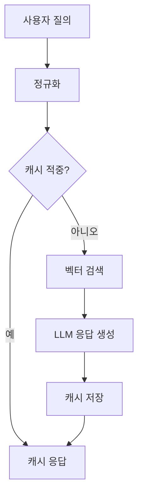

검색 파이프라인은 다음과 같습니다.



정규화 단계의 코드는 다음과 같습니다.

```typescript
export function normalize(query: string): string {
  return query.trim().toLowerCase().replace(/\s+/g, " ");
}
```

캐시 적중률이 \(p\)이면 평균 지연은 \(p \cdot t_{\text{cache}} + (1-p) \cdot t_{\text{llm}}\)입니다.
